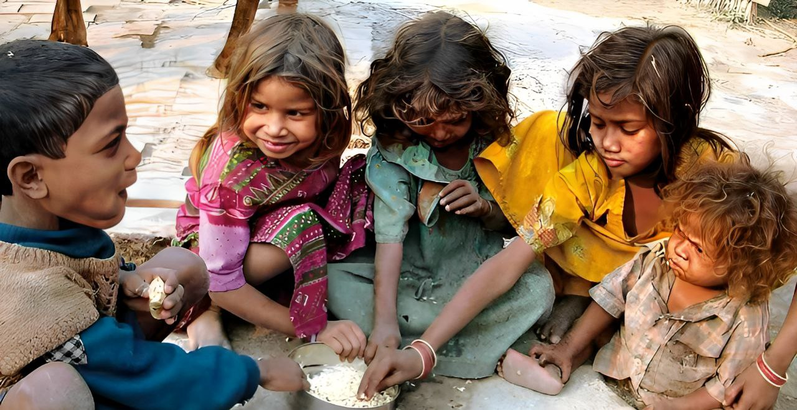
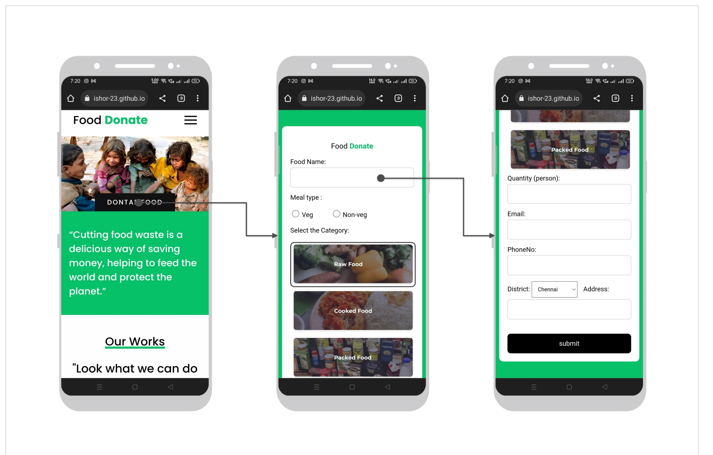
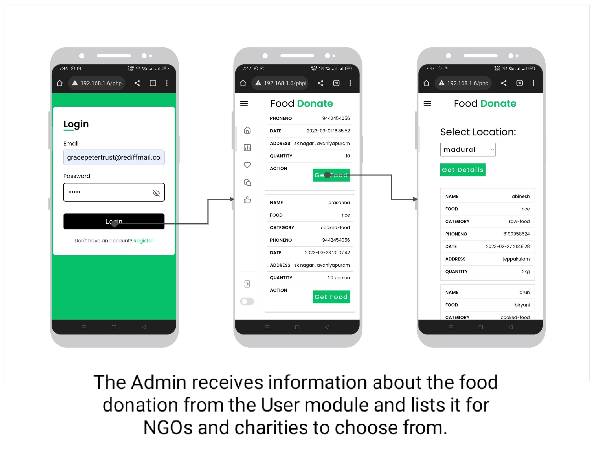
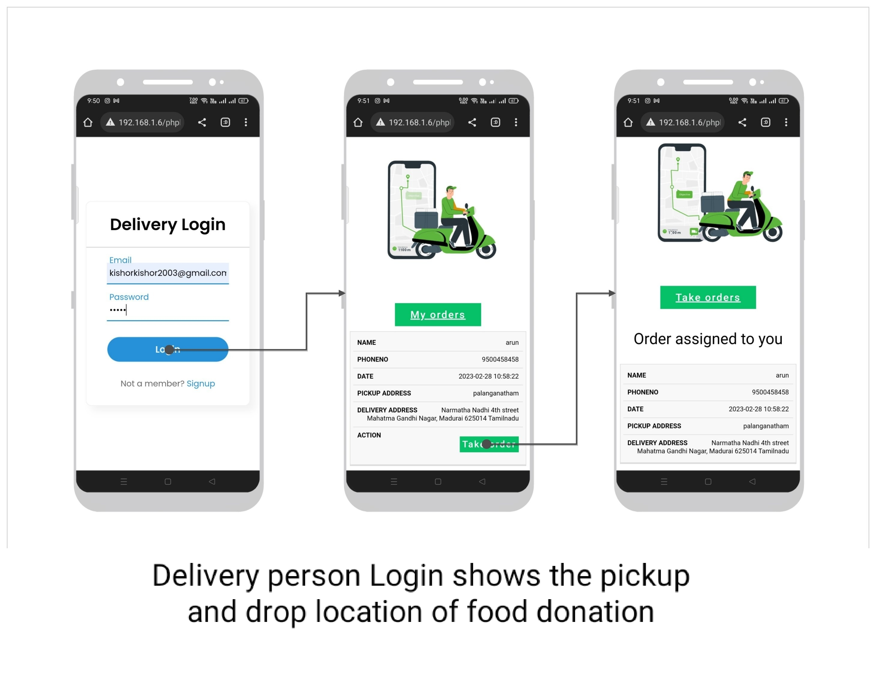
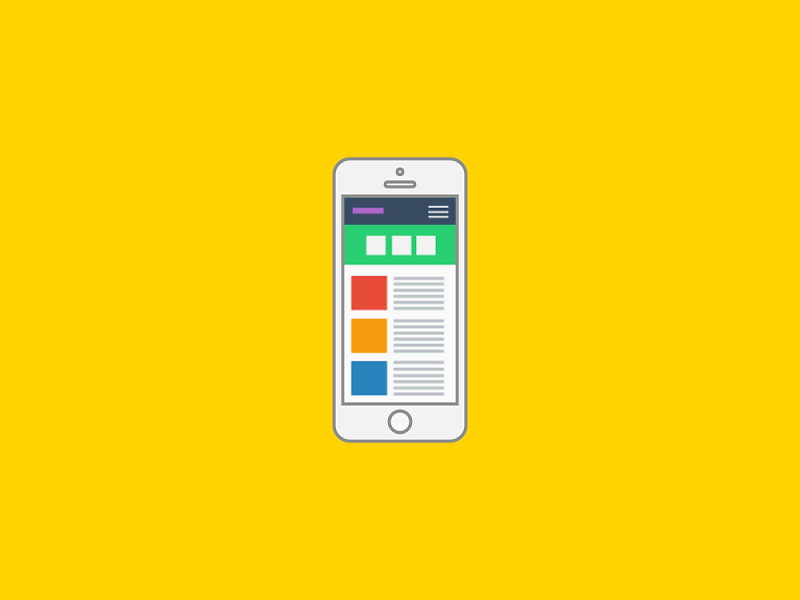
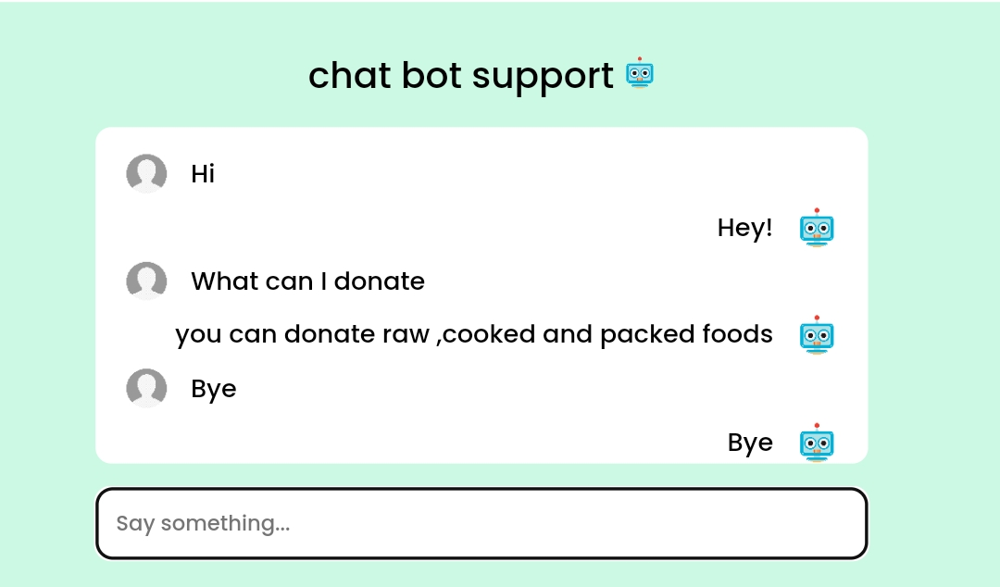
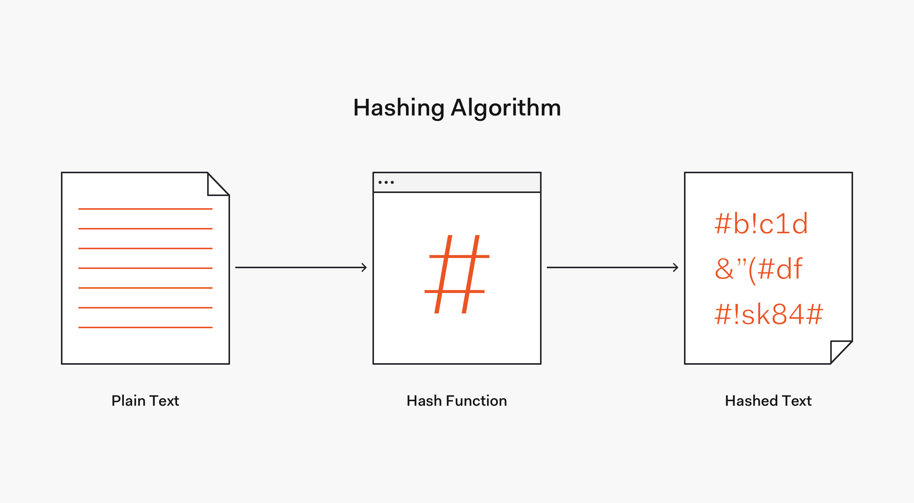

# Food waste management system
<!--  -->

  The basic concept of this project  Food Waste Management is to collect theexcess/leftover food from donors such as hotels, restaurants, marriage halls, etc and distribute to  the  needy people[...]
<h2>Tools and Technologies</h2> 
<ul>
 <li>Frontend : HTML, CSS,  JavaScript</li>
 <li>Backend  : php</li>
 <li>webserver: xampp server</li>
 <li>Database: MySQL </li>
</ul>

 <h2>The system has three modules. </h2>
    <ul><li>User</li>
    <li>Admin</li>
    <li>Delivery</li></ul>
    
    
The User module is designed for people who wish to donate their excess or leftover food to help reduce food wastage.The User module is responsible for accepting food donations from users wh[...]
   
 
   

      The Administrator module is for trusts, NGOs, and charities that are registered on the platform. The Admin module is designed for system administrators who manage the food distribution proce[...]
   
 
    
The Delivery Person module is for individuals who wish to participate in the food donation process by providing pickup and delivery services. Delivery personnel can register themselves on t[...]
    
 
    
Overall, the Food Waste Management System is designed to efficiently manage excess food and ensure that it is distributed to those in need. The User module accepts food donations, the Admin[...]
    

    <h3>User </h3>
   <!--  -->
    
    <h3>Admin </h3>
    
     <h3>Delivery </h3>
    
    <h3>features:</h3>
    <ul><li>Mobile Screen friendly website.</li>
      <li>chatbot support</li>
      <li>Secure Login</li>
      </ul>
      <h2>Mobile Screen friendly website.</h2>
      
      <h2>chatbot support</h2>
      
      <h2>Secure Login</h2>
      
      <h2>How to run</h2>
      <ol>
       <li>Download the project zip file</li>
       <li> Extract the file and copy the folder</li>
       <li>Paste inside root directory(for xampp xampp/htdocs, for wamp wamp/www, for lamp var/www/Html)</li>
       <li> Open PHPMyAdmin (http://localhost/phpmyadmin)</li>
       <li> Create a database</li>
       <li>Import demo.sql file(inside database folder)</li>
       <li> Run the script http://localhost/folderName </li> </ol>

<h2>view project :</h2>

<a href="http://localhost/food-waste-management-system-main/" > view demo</a>
